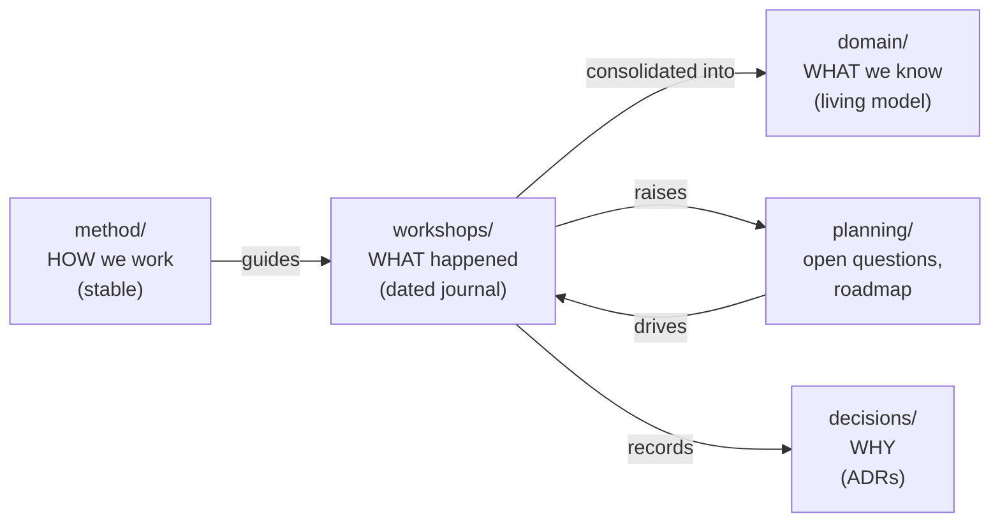

# Documentation map

> **Current phase:** 1 — Align & Discover
> **Next step:** WS02 — Big Picture EventStorming (see [`planning/roadmap.md`](planning/roadmap.md))

The documentation separates three kinds of content. Workshops **feed** the domain model; the method tells how.

## Folders

| Folder | Content |
|---|---|
| [`method/`](method/) | [Process & phases](method/process.md), [conventions](method/conventions.md), [workshop playbooks](method/playbooks/), [templates](method/templates/) |
| [`workshops/`](workshops/) | One dated folder per workshop session, never rewritten |
| [`domain/`](domain/) | [Vision](domain/vision.md), [actors](domain/actors.md), [glossary](domain/glossary.md), [event timeline](domain/event-timeline.md), [domain stories](domain/stories/); later `strategic/` and `contexts/<bounded-context>/` |
| [`decisions/`](decisions/) | Architecture & process decision records (MADR) |
| [`planning/`](planning/) | [Roadmap](planning/roadmap.md), [open questions](planning/open-questions.md), [tooling roadmap](planning/tooling-roadmap.md) |

## Status of living documents

| Document | Status |
|---|---|
| [domain/vision.md](domain/vision.md) | draft (WS00) |
| [domain/actors.md](domain/actors.md) | draft (WS00) |
| [domain/glossary.md](domain/glossary.md) | draft (15 terms agreed in WS01, others candidates) |
| [domain/event-timeline.md](domain/event-timeline.md) | draft (empty) |
