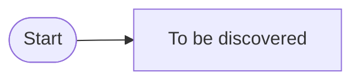

# Event timeline — Big Picture

> Empty — to be filled by Big Picture EventStorming. Notation and format: [playbook](../method/playbooks/eventstorming-big-picture.md).

## Overview

## Events by swimlane

| ID | Event | Pivotal | Triggered by | Notes / hotspots |
|---|---|---|---|---|

## Candidate boundaries

| Candidate | Evidence (language change, actor change, pivotal event…) |
|---|---|
