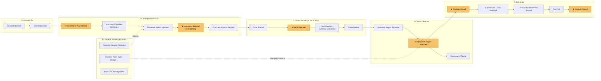

# Event timeline — Big Picture

Notation and format: [playbook](../method/playbooks/eventstorming-big-picture.md). Terms: [glossary](glossary.md). Hotspots: [open questions](../planning/open-questions.md).
The timeline covers the Investor's whole world, not only what Cumulus does. The weekly cadence and the selection rules of the current Investment method (Trident) are **not** hard-coded: they appear as policies of that method.

## Overview

Reading: the Investor funds an Account (A), decides what to buy within their Investment plan (B), places an Order at the Broker (C, outside Cumulus), then imports the Broker's Operation report (G). Issuer and market events (D) happen at any time and change Positions or their value. Selling everything closes a Position and realizes a gain or loss that is taxed (F). Pivotal events (★, highlighted) mark the phases.

## Events by swimlane

### A. Account life

| ID | Event | Pivotal | Triggered by | Notes / hotspots |
|---|---|---|---|---|
| EVT-001 | Account Opened | | ACT-001 Investor, with ACT-003…006 | Account in the broad sense (incl. life insurance contract, employee savings plan) |
| EVT-002 | Cash Deposited | | ACT-001 Investor | Incl. employee savings deposits |
| EVT-003 | PEA Reached 5 Years | | time | After it: partial withdrawals no longer close the PEA |
| EVT-004 | Cash Withdrawn | | ACT-001 Investor | Incl. life insurance surrender (*rachat*); PEA before 5 years → closes it, except legal cases |
| EVT-005 | Employee Savings Released at Maturity | | time | |
| EVT-006 | Employee Savings Released Early | | ACT-001 Investor, ACT-006 | Marriage, birth, main home purchase… |
| EVT-007 | Account Closed | ★ | ACT-001 Investor | End of a Tax regime; PEA can be closed any time, tax exemptions after 5 years |
| EVT-008 | Account Transferred | | ACT-001 Investor, ACT-003 Broker | Lots and history kept; already happened for the owner's PEA |
| EVT-009 | Transfer Fee Charged | | ACT-003 Broker | |
| EVT-027 | Fund Switched | | ACT-001 Investor, ACT-005 Insurer | Life insurance *arbitrage*; ⚠ ASSUMPTION: placed here by the agent, not discussed |

### B. Investment decision

Today most of this lane is run by the Idea source (Trident); tomorrow by the Investor, possibly helped by the AI assistant (P7).

| ID | Event | Pivotal | Triggered by | Notes / hotspots |
|---|---|---|---|---|
| EVT-010 | Community Post Published | | ACT-007 Idea source | Starts the week under the current Investment method |
| EVT-011 | Guru Analysis Published | | ACT-007 Idea source | |
| EVT-012 | Guru Position Disclosed | | ACT-007 Idea source | |
| EVT-013 | Instrument Spotted | | ACT-001 Investor or ACT-007 | |
| EVT-014 | Instrument Analyzed | | ACT-001 Investor or ACT-007 | Informed by EVT-052 |
| EVT-015 | Instrument Qualified | | ACT-007 Idea source today | Enters the Selection |
| EVT-016 | Qualified Instruments Ranked | | ACT-007 Idea source today | |
| EVT-017 | Instrument Paused | | ACT-007 Idea source today | |
| EVT-018 | Instrument Removed from Selection | | ACT-007 Idea source today | |
| EVT-019 | Instrument Selected for Purchase | ★ | POL-001 | |
| EVT-020 | Purchase Account Selected | | ACT-001 Investor | Candidate policy: PEA eligibility |
| EVT-021 | Portfolio Created | | ACT-001 Investor | |
| EVT-022 | Lot Added to Portfolio / Lot Removed from Portfolio | | ACT-001 Investor | A Lot can belong to several Portfolios |
| EVT-023 | Investment Plan Defined / Investment Plan Changed | ★ | ACT-001 Investor | Frequency, recurring deposit, capital to deploy, deployment period |
| EVT-024 | Estimated Return Updated | | ACT-007 Idea source today | Entered manually at first (Q-022) |
| EVT-025 | Purchase Amount Proposed | | POL-002 | |
| EVT-026 | Purchase Amount Decided | | ACT-001 Investor | |

### C. Order & trade (at the Broker — outside Cumulus, N1)

| ID | Event | Pivotal | Triggered by | Notes / hotspots |
|---|---|---|---|---|
| EVT-030 | Order Placed | | ACT-001 Investor | Limit price, validity (day / until date) |
| EVT-031 | Order Partially Executed | | ACT-003 Broker | |
| EVT-032 | Trade Executed | ★ | ACT-003 Broker | Money committed; a Lot is created (purchase) or consumed (sale) |
| EVT-033 | Order Expired | | ACT-003 Broker | |
| EVT-034 | Order Cancelled | | ACT-001 Investor | |
| EVT-035 | Currency Converted | | ACT-003 Broker | |
| EVT-036 | Brokerage Fee Charged | | ACT-003 Broker | |
| EVT-037 | FX Fee Charged | | ACT-003 Broker | |
| EVT-038 | Trade Settled | | ACT-003 Broker | |
| EVT-039 | Position Closed | ★ | Sale of all Lots, or a Corporate action | Q-017 |

### D. Issuer & market

| ID | Event | Pivotal | Triggered by | Notes / hotspots |
|---|---|---|---|---|
| EVT-040 | Price Updated | | ACT-009 Market data source | Q-010 |
| EVT-041 | FX Rate Updated | | ACT-009 Market data source | Q-010 |
| EVT-042 | Inflation Published | | ACT-010 Inflation statistics source | Q-002 |
| EVT-043 | Dividend Announced | | ACT-012 Issuer | |
| EVT-044 | Ex-Dividend Date Passed | | time | |
| EVT-045 | Dividend Paid | | ACT-012 Issuer, via ACT-003 Broker | |
| EVT-046 | Withholding Tax Deducted | | via ACT-003 Broker | Always shown as an Operation cost |
| EVT-047 | Stock Split Done | | ACT-012 Issuer | Already seen mishandled on Trident (R4); Q-011 |
| EVT-048 | Merger Done | | ACT-012 Issuer | Q-011, Q-017 |
| EVT-049 | Spin-off Done | | ACT-012 Issuer | Q-011 |
| EVT-050 | Capital Increase Offered | | ACT-012 Issuer | |
| EVT-051 | Takeover Offer Launched | | ACT-012 Issuer | Q-017 |
| EVT-052 | Financial Results Published | | ACT-012 Issuer | Informs EVT-014, EVT-024 |

### E. Account charges & income

| ID | Event | Pivotal | Triggered by | Notes / hotspots |
|---|---|---|---|---|
| EVT-060 | Custody Fee Charged | | ACT-003…006 Institution | |
| EVT-061 | Interest Paid | | ACT-004 Bank, ACT-005 Insurer | Livret A, euro fund |
| EVT-062 | Social Contributions Charged | | Institution | Rates change (R3) |

### F. Tax

| ID | Event | Pivotal | Triggered by | Notes / hotspots |
|---|---|---|---|---|
| EVT-070 | Capital Gain Realized / Capital Loss Realized | | follows EVT-032 (sale) or EVT-039 | CTO: computed on the PMP |
| EVT-071 | Tax Declared | | ACT-001 Investor | |
| EVT-072 | Tax Paid | | ACT-001 Investor, ACT-011 Tax authority | |
| EVT-073 | Annual Tax Statement Issued | | ACT-003 Broker | IFU; the Broker also sends it to the tax administration |
| EVT-074 | Pre-filled Tax Return Checked | | ACT-001 Investor | The owner checks the pre-filled values against the IFU |

### G. Record keeping

| ID | Event | Pivotal | Triggered by | Notes / hotspots |
|---|---|---|---|---|
| EVT-080 | Operation Report Exported | | ACT-001 Investor, on demand at ACT-003 Broker | |
| EVT-081 | Operation Report Imported | ★ | ACT-001 Investor | The report holds enough to rebuild the real cost (Q-018); de-duplication Q-019 |
| EVT-082 | Operation Entered Manually | | ACT-001 Investor | Bank, insurer and employee savings Accounts |
| EVT-083 | Discrepancy Found | | Cumulus, POL-003 | The Broker is the reference; Cumulus only reports (Q-020) |

## Policies

| ID | Policy | Scope |
|---|---|---|
| POL-001 | Whenever a purchase is due, propose the Instrument of the Selection with an estimated return ≥ 10 %/yr on which the Investor has the smallest amount invested | Current Investment method (Trident); "amount invested": Q-021 |
| POL-002 | Proposed purchase amount = recurring deposit + capital to deploy ÷ deployment period (e.g. 1,000 € + 50,000 € ÷ 20) | Current Investment plan (dollar-cost averaging) |
| POL-003 | Whenever Operations are imported, check that every cost is explained and that records match; report any Discrepancy | Cumulus |
| POL-004 | Whenever a Corporate action ends a Position, it generates the Operations that close it: cash takeover = sale at the offer price; share exchange = Lots replaced, acquisition cost carried over; delisting / bankruptcy = value to zero | ⚠ tax treatment to verify (Q-017) |

## Read models (information needs)

Financial wealth and Portfolio performance · Instrument performance · Instrument price · Performance charts. They feed Investment decisions; they are not events.

## Candidate boundaries

| Candidate | Evidence (language change, actor change, pivotal event…) |
|---|---|
| Operation records | Own language (Operation report, import, Operation, Lot, discrepancy); ★ Operation Report Imported; facts come from the Broker, who is the reference |
| Instrument & market reference | Language of Issuers and markets (Corporate action, price, FX rate, inflation); actors Issuer, Market data source, Inflation source; issuer-side vs account-side split (WS01) |
| Valuation & performance | Language of Currency effect, Inflation-adjusted, Gross / Net, Annualized performance; consumes records and reference data; no events of its own |
| Taxation | Language of Tax regime, PMP, realized gain, social contributions, IFU; actor Tax authority; ★ Position Closed, ★ Account Closed; rules change often (R3) |
| Investment decision | Language of Selection, Estimated return, Investment plan; **actor changes over time** (Idea source → Investor / AI assistant); method-specific policies; ★ Investment Plan Defined, ★ Instrument Selected for Purchase |
| Outside Cumulus: order execution | Happens at the Broker (N1); Cumulus only sees results through the Operation report |
