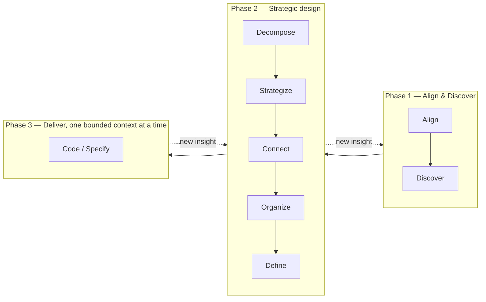

# Discovery & design process

The process follows the **DDD Starter Modelling Process** published by the DDD Crew
(<https://github.com/ddd-crew/ddd-starter-modelling-process>, CC BY-SA 4.0), grouped into three phases.
It is **iterative**: any later step may send us back to an earlier one when new knowledge appears.

## Phases

### Phase 1 — Align & Discover *(current)*

| Step | Question | Techniques | Main outputs |
|---|---|---|---|
| Align | Why does this project exist, for whom, what does success look like? | Project brief, Impact Mapping (optional), Business Model Canvas (optional) | `domain/vision.md`, `domain/actors.md` |
| Discover | What happens in the business, in what order, and where does it hurt? | Big Picture EventStorming, Domain Storytelling | `domain/event-timeline.md`, `domain/glossary.md`, domain stories, open questions |

**Exit criteria**
- Vision validated by the owner (problem, users, goals, non-goals, constraints).
- An end-to-end event timeline covering the main flows, with pivotal events identified.
- A glossary of the core terms (≥ the terms used in pivotal events), each with a definition.
- Hotspots prioritized; the ones that block decomposition are answered.
- Candidate boundaries emerging from the timeline (swimlanes / pivotal events) are listed.

### Phase 2 — Strategic design

| Step | Question | Techniques | Main outputs |
|---|---|---|---|
| Decompose | Where are the natural boundaries? | Sub-domain identification, boundary heuristics | `domain/strategic/subdomains.md` |
| Strategize | What differentiates us and deserves the most effort? | Core Domain Chart | `domain/strategic/core-domain-chart.md` |
| Connect | How do parts collaborate? | Domain Message Flow Modelling | `domain/strategic/message-flows/` |
| Organize | Who owns what? | Team Topologies (light, solo owner at first) | ADR if relevant |
| Define | What is each bounded context responsible for? | Bounded Context Canvas, Context Mapping | `domain/contexts/<bc>/canvas.md`, `domain/strategic/context-map.*` |

**Exit criteria**: a context map with every bounded context classified (core / supporting / generic) and a validated canvas for at least the first context to deliver.

### Phase 3 — Deliver (per bounded context)

Process-level EventStorming, Example Mapping → Gherkin scenarios, EARS requirements, Aggregate Design Canvas, then technical decisions (ADRs) and implementation.
Tools for this phase are listed in [`planning/tooling-roadmap.md`](../planning/tooling-roadmap.md).

## Workshop lifecycle

Every workshop, whatever its type, follows the same five steps.

| # | Step | Who | Output |
|---|---|---|---|
| 1 | **Prepare** — pick the playbook, list inputs (previous records, open questions) | agent | agenda in the record |
| 2 | **Run** — follow the playbook step by step, one question at a time | owner + agent | raw notes in the record |
| 3 | **Record** — write `workshops/<date>-ws<NN>-<slug>/record.md` from the [template](templates/workshop-record.md) | agent | record |
| 4 | **Consolidate** — update living documents in `domain/`, add open questions, list every change in the record; then update project state: workshop status and next step in [`planning/roadmap.md`](../planning/roadmap.md), the *Next step* line and status table in [`docs/README.md`](../README.md), the index in [`workshops/README.md`](../workshops/README.md) | agent | updated `domain/`, `planning/`, `docs/README.md` |
| 5 | **Review** — owner reads the diff, corrects, validates; statuses move `draft → reviewed → validated` | owner | statuses updated |

## Workshop catalog

| Playbook | Phase | Purpose |
|---|---|---|
| [brief](playbooks/brief.md) | 1 | Capture vision, problem, actors, goals, constraints |
| [eventstorming-big-picture](playbooks/eventstorming-big-picture.md) | 1 | Explore the whole domain as a timeline of events |
| [domain-storytelling](playbooks/domain-storytelling.md) | 1 | Describe one concrete scenario as actors working on work objects |
| [ubiquitous-language](playbooks/ubiquitous-language.md) | all | Define, disambiguate and maintain terms |

Further playbooks (sub-domains, core domain chart, bounded context canvas, example mapping…) are written when their phase starts.
