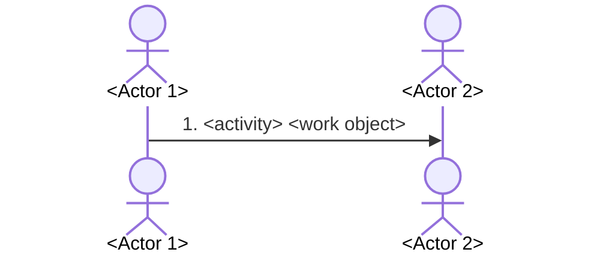

# DS-<NNN> — <story title>

<One sentence: which concrete example this story tells.>

| # | Actor | Activity | Work object | With / to |
|---|---|---|---|---|
| 1 | ACT-NNN <actor> | <verb> | <work object> | ACT-NNN <actor> |

## Variants and exceptions
- <variant> → DS-NNN or Q-NNN

## Open questions
- Q-NNN <question>
